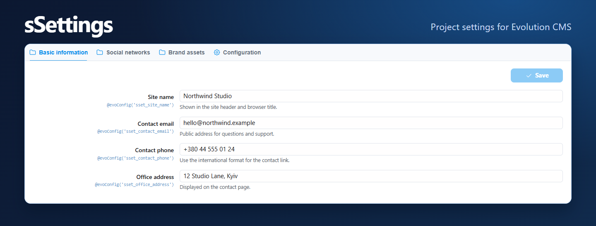

# sSettings for Evolution CMS

[](https://packagist.org/packages/seiger/ssettings)
[](https://github.com/evolution-cms/evolution)
[](#compatibility)
[](https://packagist.org/packages/seiger/ssettings)
[](https://github.com/Seiger/ssettings/issues)
[](https://packagist.org/packages/seiger/ssettings)
[](https://packagist.org/packages/seiger/ssettings)


**sSettings** is a powerful plugin meticulously crafted for Evolution CMS, providing an
extensive array of advanced settings to elevate your website's customization capabilities.
Tailored by Seiger, this plugin empowers website administrators and developers with a
seamless solution for configuring and fine-tuning various aspects of their online presence.

Designed to seamlessly integrate with Evolution CMS, **sSettings** is your go-to solution for
unlocking advanced customization options. Whether you are a seasoned developer or a
website administrator, this plugin offers an intuitive interface for configuring your
website's settings to align precisely with your vision. Experience the next level of
control and flexibility with **sSettings**.

## Features

- [x] Checkbox field type.
- [x] File field type.
- [x] Image field type.
- [x] Listbox and dropdown option field types.
- [x] Radio and checkbox group field types.
- [x] RichText field type.
- [x] Text field type.
- [x] Textarea field type.
- [x] TextareaMini field type.

## Install by artisan package installer

Go to You /core/ folder:

```console
cd core
```

Run php artisan command

```console
php artisan package:installrequire seiger/ssettings "^2.0"
```

```console
php artisan vendor:publish --provider="Seiger\sSettings\sSettingsServiceProvider"
```

## Compatibility

sSettings 2.x supports PHP 8.4 and 8.5. It requires Evolution CMS 3.5.8 or later in the 3.x line and EvoUI 1.3 or later in the 1.x line.

Package checks also passed on the PHP 8.6.0 RC5 preview.

## Documentation

File-first dDocs documentation lives in `docs/`:

- [English](docs/en/README.md)
- [Ukrainian](docs/ua/README.md)
- [Polish](docs/pl/README.md)
- [German](docs/de/README.md)
- [French](docs/fr/README.md)

The [documentation site](https://seiger.github.io/sSettings/) has current 2.x
guides and a [1.x archive](https://seiger.github.io/sSettings/1.x/). Its build
configuration lives in the [`docs` branch](https://github.com/Seiger/sSettings/tree/docs).
See [GitHub Releases](https://github.com/Seiger/sSettings/releases) for changes
in individual versions.

## Release Checks

Run the release gate from the package root before tagging or committing a
manager UI release:

```console
composer validate --strict --no-check-publish
composer test
php tests/run.php
```

Schema saving validates generated PHP in the current process, including on
PHP-FPM/FastCGI hosts where `PHP_BINARY` is not a CLI executable. The isolated
write regression never bootstraps the CMS or modifies the site's config or database:

```console
SSETTINGS_DEMO_CORE=/path/to/site/core php tests/schema-write.php
SSETTINGS_DEMO_CORE=/path/to/site/core php -d disable_functions=exec tests/schema-write.php
```

Set `SSETTINGS_NON_CLI_BINARY=/path/to/php-fpm` to exercise the non-CLI runtime
case. `composer test` runs this write regression before the existing manager smoke suite.
