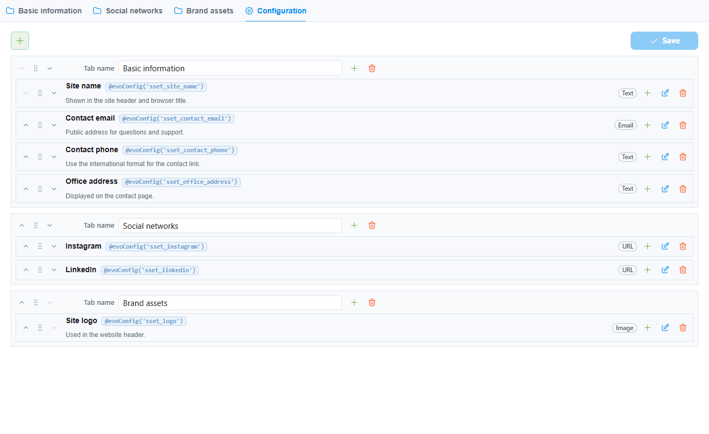
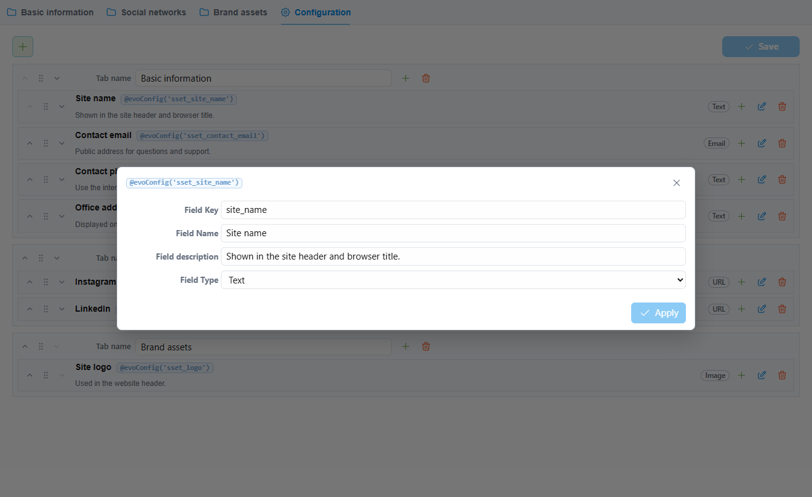

# sSettings Dokumentation

sSettings fügt dem Evolution CMS Manager einen kompakten Einstellungsbereich
hinzu. Das Modul verwaltet projektweite Werte wie E-Mail-Adressen, Telefonnummern,
Social Links, Tracking-Skripte, Dateien, Bilder und Konfigurationsflags.

## Einstellungsansicht

## Anleitungen

- [Benutzerhandbuch](user-guide.md)
- [Entwicklerhandbuch](developer-guide.md)
- [Frontend-Handbuch](frontend-guide.md)
- [Versionen und Kompatibilität](releases.md)

## Hauptfunktionen

- Projektwerte in einer kompakten evo-ui Oberfläche bearbeiten.
- Felder in Tabs wie Basisinformationen und Soziale Netzwerke gruppieren.
- Tabs und Felder im Manager konfigurieren, wenn der Benutzer die Berechtigung
  `settings` hat.
- Werte als Evolution Systemeinstellungen mit dem Präfix `sset_` speichern.
- Werte in Blade oder Evolution Templates über `evo()->getConfig()` verwenden.
