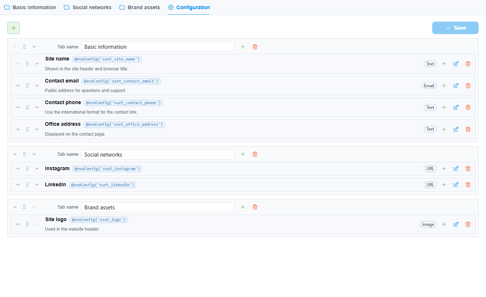
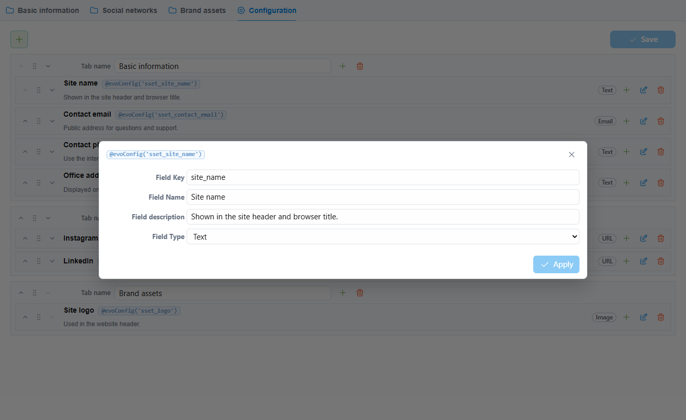

# Dokumentacja sSettings

sSettings dodaje kompaktowy obszar ustawień do managera Evolution CMS. Moduł
służy do wartości globalnych projektu: adresów email, telefonów, linków
społecznościowych, skryptów śledzenia, plików, obrazów i flag konfiguracyjnych.

## Ekran ustawień

## Przewodniki

- [Przewodnik użytkownika](user-guide.md)
- [Przewodnik developera](developer-guide.md)
- [Przewodnik frontendowy](frontend-guide.md)
- [Wersje i zgodność](releases.md)

## Główne możliwości

- Edycja ustawień projektu w kompaktowym interfejsie evo-ui.
- Grupowanie pól w zakładki, na przykład Informacje podstawowe i Sieci
  społecznościowe.
- Konfigurowanie zakładek i pól w managerze, jeśli użytkownik ma uprawnienie
  `settings`.
- Zapisywanie wartości jako ustawień systemowych Evolution z prefiksem `sset_`.
- Używanie wartości w Blade lub szablonach Evolution przez `evo()->getConfig()`.
